# Chhattisgarh Rural Road Accessibility & Network Analysis (2022–2026)

[](https://www.python.org/)
[](https://github.com/astral-sh/uv)
[](https://github.com/astral-sh/ruff)
[](https://github.com/microsoft/pyright)
[](https://coderabbit.ai)
[](https://geopandas.org/)
[](https://leafletjs.com/)
[](https://opensource.org/licenses/MIT)

> ## Documentation Index
> Fetch the complete CodeRabbit documentation index at: https://docs.coderabbit.ai/llms.txt  
> Use this file to discover all available pages before exploring further.

---

## 📌 Executive Master Infographic Dashboard

<div style="margin: 2cm auto; text-align: center; clear: both;">
  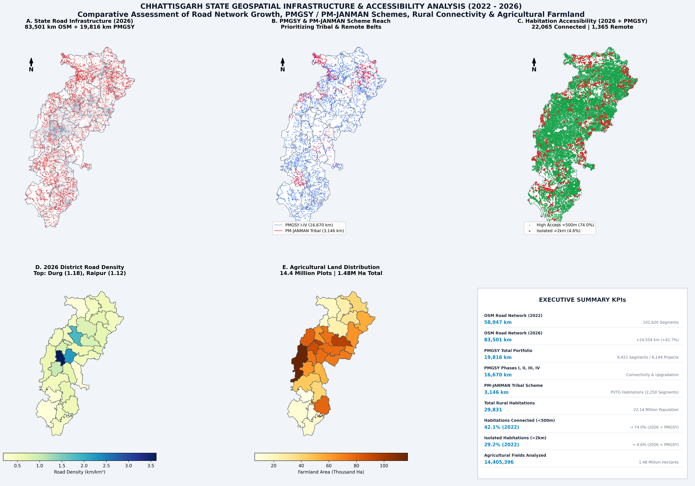
  <p style="margin-top: 12px; font-weight: 600; color: #475569; font-size: 0.95rem;">Figure 1: Consolidated Multi-Panel Geospatial Infrastructure & Accessibility Master Dashboard (2022–2026)</p>
</div>

---

## 🌟 Project Overview

This study delivers an empirical, multi-temporal geospatial accessibility and network analysis of Chhattisgarh State spanning **2022 to 2026**. By integrating high-resolution **OpenStreetMap (OSM) road networks**, the central government's **Pradhan Mantri Gram Sadak Yojana (PMGSY Phases I, II, III, IV)** and **PM-JANMAN (Pradhan Mantri Janjati Adivasi Nyaya Maha Abhiyan)** scheme data, **29,831 rural habitations** (housing 22.14 million residents), and **14,405,396 agricultural field parcels** (1.48 million hectares), this analysis quantifies rural connectivity shifts, infrastructure expansion, and farm-to-market transport linkages.

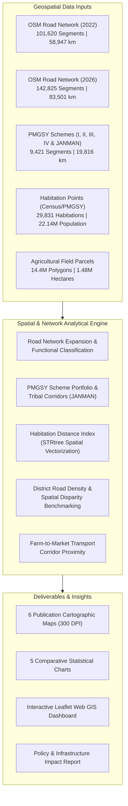

---

## 🚀 Key Analytical Metrics & Findings

| Core Metric / Dimension | Baseline (2022) | Horizon (2026 / Integrated) | Net Impact / Change |
| :--- | :---: | :---: | :---: |
| **Total Road Network Length (OSM)** | 58,946.9 km | **83,500.6 km** | **+24,553.7 km (+41.65%)** |
| **Total Road Segments (OSM)** | 101,620 links | **142,825 links** | **+41,205 links (+40.55%)** |
| **Rural Collector Roads (`unclassified`)** | 14,481.2 km | **25,156.4 km** | **+10,675.2 km (+73.72%)** |
| **Tertiary Rural Roads** | 15,224.7 km | **21,630.1 km** | **+6,405.4 km (+42.07%)** |
| **PMGSY Rural Scheme Portfolio** | - | **19,816.3 km** | **9,421 Segments / 6,144 Projects** |
| **PM-JANMAN Tribal PVTG Schemes** | - | **3,146.1 km** | **2,250 Segments (PVTG Priority)** |
| **Habitations with High Road Access (<500m)** | 12,552 (42.08%) | **22,065 (73.97%)** | **+9,513 Habitations (+31.89%)** |
| **Population with High Road Access (<500m)** | 12.62M (57.03%) | **17.98M (81.22%)** | **+5.36M People Connected** |
| **Isolated Rural Habitations (>2km from road)**| 8,710 (29.20%) | **1,365 (4.58%)** | **Plummeted by 84.3%** |
| **Agricultural Farmland Analyzed** | - | **14,405,396 Fields** | **1.48 Million Hectares** |

---

## 🗺️ Visual Cartography & Comparative Maps

> All maps are generated with standalone styling, generous margins (2cm), and no overlapping text or geometry.

### 1. Road Network Expansion (2022 vs 2026)
Dual-panel comparative cartography showing the baseline 2022 OSM road network alongside the expanded 2026 network, highlighting 41,205 newly mapped and constructed road links in red.

<div style="margin: 2cm auto; text-align: center; clear: both;">
  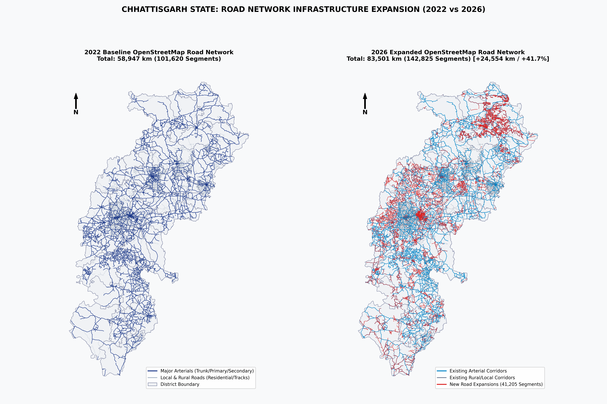
  <p style="margin-top: 12px; font-weight: 600; color: #475569; font-size: 0.95rem;">Figure 2: Chhattisgarh State Road Network Infrastructure Expansion (2022 vs. 2026)</p>
</div>

---

### 2. PMGSY Phases I–IV & PM-JANMAN Scheme Reach
Full-state cartographic alignment map displaying the multi-phase footprint of rural roads:
- **PMGSY Phase I**: 3,199 km (Core connectivity)
- **PMGSY Phase II**: 2,190 km (Through routes upgradation)
- **PMGSY Phase III**: 5,613 km (Major Rural Links to GrAMs and hospitals)
- **PMGSY Phase IV**: 5,668 km (Modern rural corridors)
- **PM-JANMAN**: 3,146 km (Targeted PVTG tribal habitations in Bastar, Sukma, Bijapur, Narayanpur)

<div style="margin: 2cm auto; text-align: center; clear: both;">
  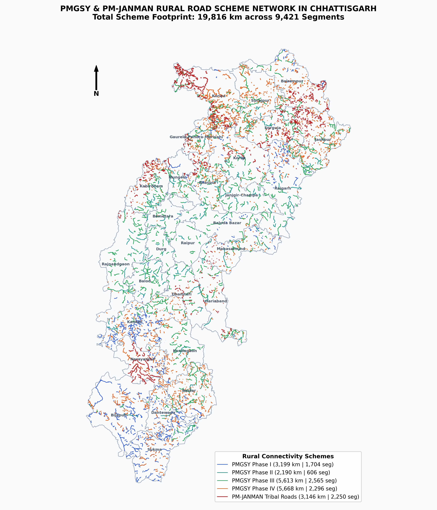
  <p style="margin-top: 12px; font-weight: 600; color: #475569; font-size: 0.95rem;">Figure 3: Geographic Reach of PMGSY Schemes I–IV and PM-JANMAN Tribal Alignments</p>
</div>

---

### 3. Habitation Accessibility & Proximity Classification
Spatial distribution of 29,831 rural habitations color-coded into accessibility tiers:
- 🟢 **High Accessibility (<500m)**: 22,065 habitations (74.0%) | 17.98M population (81.2%)
- 🟡 **Moderate Accessibility (500m–1km)**: 3,280 habitations (11.0%) | 1.77M population (8.0%)
- 🟠 **Low Accessibility (1km–2km)**: 3,118 habitations (10.5%) | 1.76M population (7.9%)
- 🔴 **Isolated Settlements (>2km)**: 1,365 habitations (4.6%) | 0.63M population (2.8%)

<div style="margin: 2cm auto; text-align: center; clear: both;">
  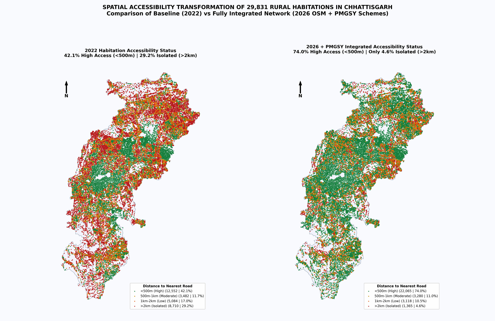
  <p style="margin-top: 12px; font-weight: 600; color: #475569; font-size: 0.95rem;">Figure 4: Spatial Transformation of Rural Habitation Accessibility (Baseline 2022 vs. Fully Integrated 2026 + PMGSY)</p>
</div>

---

### 4. District Road Density Comparative Choropleth
Statewide density map comparing road length per square kilometer (km/km²) across all 28 districts.

<div style="margin: 2cm auto; text-align: center; clear: both;">
  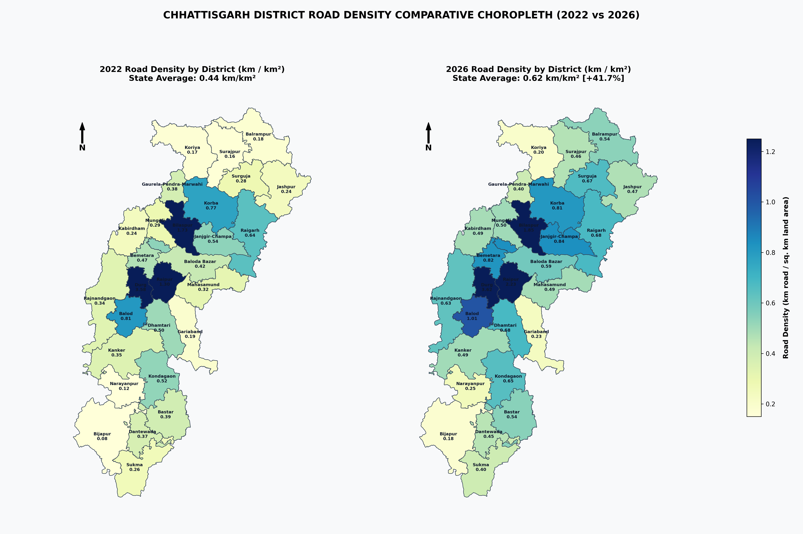
  <p style="margin-top: 12px; font-weight: 600; color: #475569; font-size: 0.95rem;">Figure 5: District Road Density Evolution (2022 vs. 2026) in km/km²</p>
</div>

---

### 5. Agricultural Farmland & Transport Corridors
Farmland distribution across 14.4 million parcels and 1.48 million hectares overlaid with major arterial transport corridors and PMGSY feeder networks.

<div style="margin: 2cm auto; text-align: center; clear: both;">
  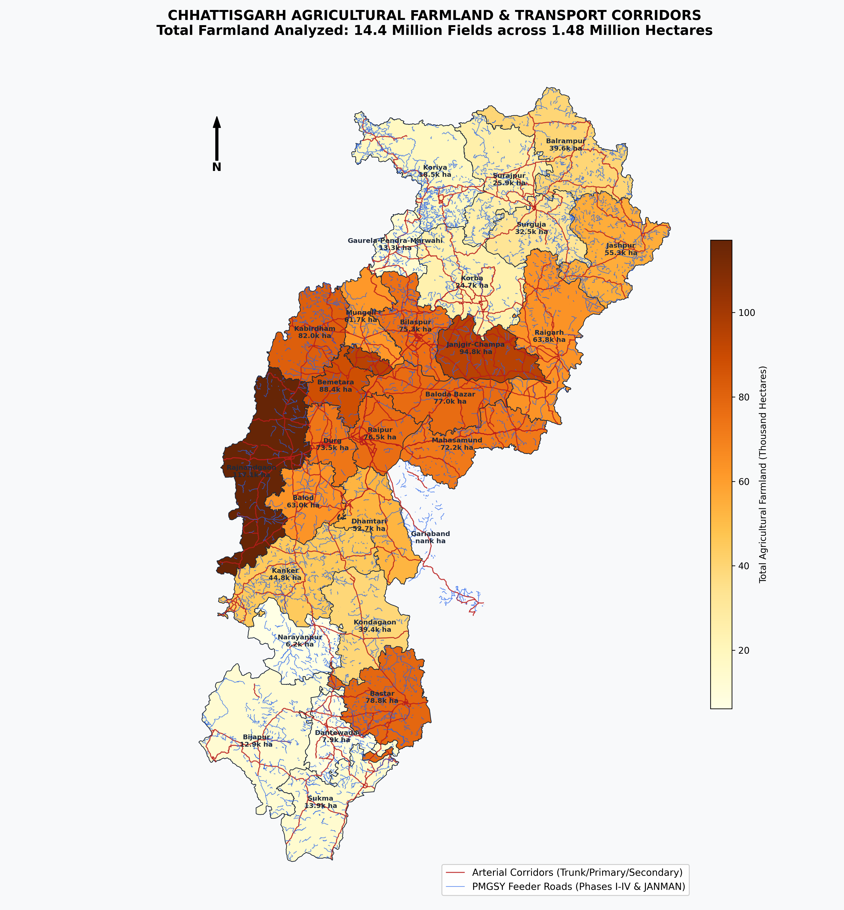
  <p style="margin-top: 12px; font-weight: 600; color: #475569; font-size: 0.95rem;">Figure 6: Agricultural Farmland Intensity and Farm-to-Market Road Corridors</p>
</div>

---

## 📊 Comparative Statistical Charts

<div style="margin: 2cm auto; clear: both; display: flex; flex-wrap: wrap; justify-content: space-between; gap: 24px;">
  <div style="flex: 1 1 48%; min-width: 320px; text-align: center;">
    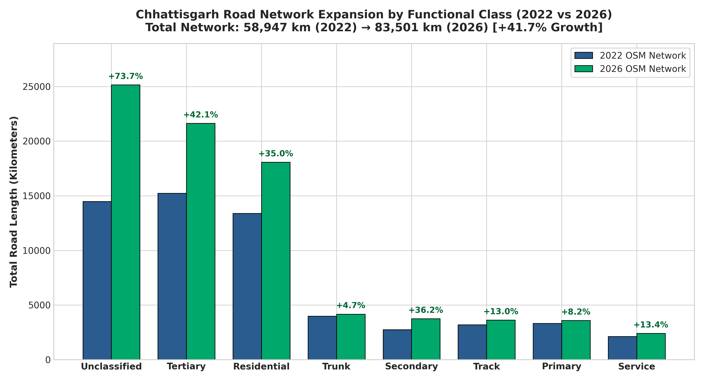
    <p style="margin-top: 8px; font-size: 0.85rem; font-weight: 600; color: #475569;">Chart 1: Road Length Expansion by Functional Class</p>
  </div>
  <div style="flex: 1 1 48%; min-width: 320px; text-align: center;">
    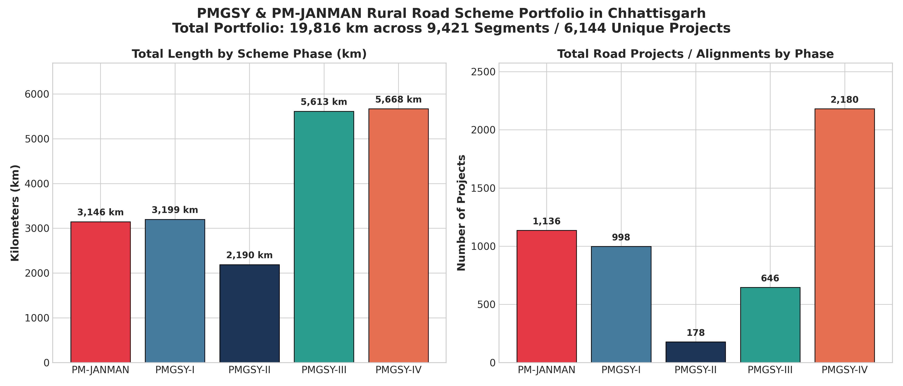
    <p style="margin-top: 8px; font-size: 0.85rem; font-weight: 600; color: #475569;">Chart 2: PMGSY Portfolio Length & Projects by Phase</p>
  </div>
</div>

<div style="margin: 2cm auto; clear: both; display: flex; flex-wrap: wrap; justify-content: space-between; gap: 24px;">
  <div style="flex: 1 1 48%; min-width: 320px; text-align: center;">
    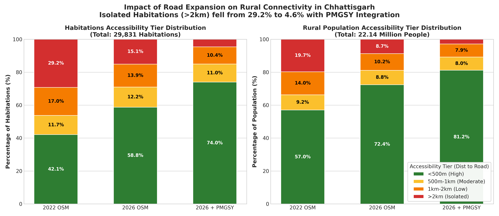
    <p style="margin-top: 8px; font-size: 0.85rem; font-weight: 600; color: #475569;">Chart 3: Population & Habitation Accessibility Shift</p>
  </div>
  <div style="flex: 1 1 48%; min-width: 320px; text-align: center;">
    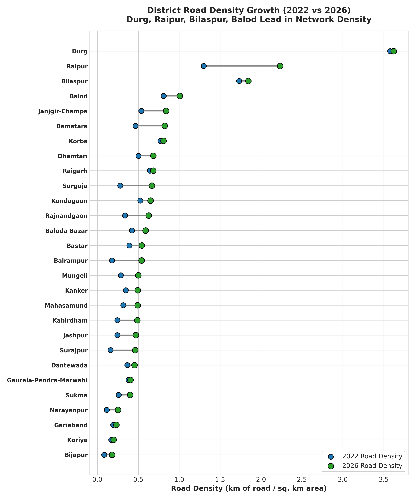
    <p style="margin-top: 8px; font-size: 0.85rem; font-weight: 600; color: #475569;">Chart 4: District Road Density Growth Rankings</p>
  </div>
</div>

<div style="margin: 2cm auto; text-align: center; clear: both;">
  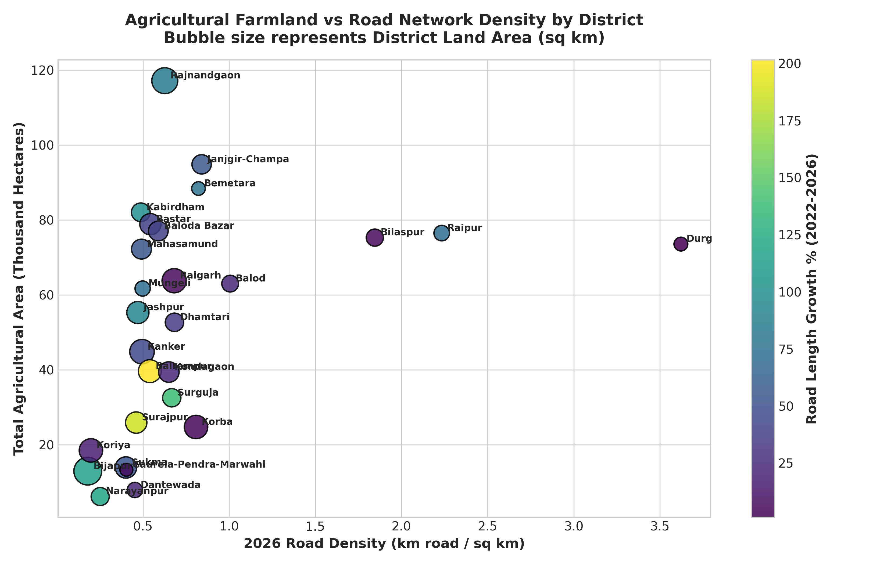
  <p style="margin-top: 8px; font-size: 0.85rem; font-weight: 600; color: #475569;">Chart 5: Agricultural Farmland vs. Road Network Density Correlation</p>
</div>

---

## 🌐 Interactive Web GIS Dashboard

The project features a dedicated standalone HTML Web GIS application powered by Leaflet.js:
- **File**: `chhattisgarh_road_accessibility_dashboard.html`
- **Features**:
  - Full Leaflet vector map with dark basemap optimized for geospatial contrast.
  - Interactive District Choropleth with live hover/click inspection cards showing area, population, road density, % connected habitations, and farmland area.
  - Filterable PMGSY scheme layers (Phases I, II, III, IV, and PM-JANMAN) with individual project work names, lengths, and IMS sanction years.
  - Sampled Habitation points color-coded by accessibility tiers (<500m, 500m-1km, 1-2km, >2km) with popups indicating village name and exact distance to road.

---

## ⚡ Fast Python Tooling: Astral `uv` Integration

This repository is optimized for [uv](https://github.com/astral-sh/uv), an extremely fast Python package and environment manager written in Rust.

### Why `uv`?
- **10–100× Faster**: Replaces traditional `pip`, `pip-tools`, and `virtualenv`.
- **Instant Virtualenvs**: Creates isolated environments in milliseconds.
- **Deterministic Resolution**: Universal cross-platform dependency locking.

### Getting Started with `uv`

```bash
# 1. Install uv (if not already installed)
# Windows (PowerShell):
powershell -ExecutionPolicy ByPass -c "irm https://astral.sh/uv/install.ps1 | iex"
# Linux / macOS:
curl -LsSf https://astral.sh/uv/install.sh | sh

# 2. Create and activate a virtual environment
uv venv
# On Windows:
.venv\Scripts\activate
# On Linux/macOS:
source .venv/bin/activate

# 3. Install all geospatial dependencies in seconds
uv pip install -r requirements.txt

# 4. Run scripts directly with auto-managed environments
uv run python process_roads.py
uv run python process_habitation_accessibility.py
uv run python generate_graphs.py
uv run python generate_maps.py
uv run python build_interactive_dashboard.py
```

---

## 🤖 CodeRabbit AI Integration Guide

[CodeRabbit](https://coderabbit.ai) provides automated, contextual AI code reviews for pull requests on GitHub repositories.

### Prerequisites
- A GitHub account with **owner-level permissions** for this repository.
- If authorizing for an organization, **organization owner permissions** are required.

### Setup & Authorization Instructions

1. **Visit CodeRabbit Login**: Navigate to [https://app.coderabbit.ai/login](https://app.coderabbit.ai/login).
2. **Initiate GitHub Login**: Click **Login with GitHub** and authorize the application.
3. **Select Organization / Account**: Choose `akshit-rgb` (or your target organization).
4. **Choose Repository Access**:
   - Select **Only select repositories** and check `Rural-Road-Accessibility-Network-Analysis-2022-2026-`.
5. **Review & Grant Permissions**:
   - **Read-only access**: Actions, discussions, members, metadata, and merge queues.
   - **Read-and-write access**: Checks, code, commit statuses, issues, pull requests, and workflows (`.github/workflows/`).
6. **Complete Installation**: Click **Install & Authorize**.

### CodeRabbit Configuration (`.coderabbit.yaml`)

This repository includes a configured `.coderabbit.yaml` file:

```yaml
# yaml-language-server: $schema=https://coderabbit.ai/integrations/schema.v2.json
language: "en-US"
early_access: false
reviews:
  profile: "chill"
  request_changes_workflow: false
  high_level_summary: true
  poem: false
  review_status: true
  collapse_walkthrough: false
  auto_review:
    enabled: true
    drafts: false
    base_branches:
      - "main"
chat:
  auto_reply: true
```

### Troubleshooting IP Allow Lists

If your GitHub organization enforces IP allowlists, ensure CodeRabbit egress IP addresses are whitelisted:

```text
35.222.179.152/32, 34.170.211.100/32, 136.113.208.247/32
```

---

## 🛠️ Modern Python Tooling & Quality Standards

### 1. Centralized Project Metadata (`pyproject.toml`)
This repository standardizes project specification under PEP 621 using `pyproject.toml`, defining all runtime dependencies, dev toolchains, and strict linter configurations in a single declarative file.

### 2. Ruff Linter & Formatter (`astral-sh/ruff`)
[Ruff](https://github.com/astral-sh/ruff) delivers near-instantaneous linting and auto-formatting:
- **Rules Enforced**: `E`/`W` (pycodestyle), `F` (Pyflakes), `I` (isort), `B` (flake8-bugbear), `UP` (pyupgrade), `RUF` (Ruff rules), `PTH` (pathlib), `SIM` (simplify).
- **Execution**:
  ```bash
  uv run ruff check . --fix
  uv run ruff format .
  ```

### 3. Pyright Static Type Checker in Strict Mode (`microsoft/pyright`)
[Pyright](https://github.com/microsoft/pyright) is configured in **`strict`** mode under `[tool.pyright]` in `pyproject.toml`:
- Enforces strict parameter, return, and variable type inference across all analysis modules.
- **Execution**:
  ```bash
  uv run pyright .
  ```

### 4. Modern Python Typing Architecture (`typing_schema.py`)
This repository defines structural type safety utilizing modern Python typing constructs:
- **`Protocol` (Structural Subtyping)**: `SpatialIndexTree` and `NetworkMetricCalculator` runtime-checkable protocols decouple geometry implementations from distance solvers.
- **`TypedDict` (Schema Validation)**: `HabitationFeatureRecord`, `DistrictSummaryRecord`, and `SchemePortfolioRecord` type-check tabular datasets and GeoJSON dictionaries.
- **`Literal` (Domain Safety)**: Constrains categories such as `AccessibilityTier` (`"<500m (High)"`, `">2km (Isolated)"`), `PMGSYScheme` (`"PMGSY-I"`, `"PM-JANMAN"`), and `RoadFunctionalClass`.

---

## 📁 Repository Directory Structure

```
├── pyproject.toml                            # Centralized project, uv, ruff & pyright configuration
├── typing_schema.py                          # Protocol, TypedDict & Literal definitions (Strict Pyright)
├── .coderabbit.yaml                          # CodeRabbit automated AI review rules
├── requirements.txt                          # Locked runtime dependencies
├── figures/                                   # 300 DPI high-resolution figures & maps
│   ├── map_1_road_network_evolution_2022_2026.png
│   ├── map_2_pmgsy_schemes_chhattisgarh.png
│   ├── map_3_habitation_accessibility.png
│   ├── map_4_district_road_density_choropleth.png
│   ├── map_5_agricultural_road_accessibility.png
│   ├── map_6_chhattisgarh_accessibility_master_dashboard.png
│   ├── graph_1_road_classes_2022_vs_2026.png
│   ├── graph_2_pmgsy_schemes_breakdown.png
│   ├── graph_3_habitation_accessibility_shift.png
│   ├── graph_4_district_density_growth.png
│   └── graph_5_agri_vs_road_density.png
├── chhattisgarh_road_accessibility_dashboard.html # Interactive Web GIS Leaflet Dashboard
├── cg_districts_clean.gpkg                   # Standardized clean district boundaries (GeoPackage)
├── pmgsy_all_schemes.gpkg                    # Integrated PMGSY I-IV & PM-JANMAN roads (GeoPackage)
├── habitations_accessibility.gpkg            # 29,831 Habitations with distance metrics (GeoPackage)
├── master_district_analytics.csv             # District benchmarking dataset (28 districts)
├── road_class_comparison_2022_2026.csv       # Functional road classification growth metrics
├── pmgsy_phase_summary.csv                   # PMGSY scheme phase summary
├── pmgsy_district_scheme_summary.csv         # District allocation of PMGSY schemes
├── habitation_accessibility_summary.csv      # Population & habitation accessibility tiers
├── district_habitation_accessibility.csv     # District-level habitation connectivity
├── agri_district_summary.csv                 # District farm acreage & field count summary
├── process_roads.py                          # Script for processing OSM & PMGSY networks
├── process_habitation_accessibility.py       # Vectorized nearest-neighbor accessibility script
├── generate_graphs.py                        # Script for generating statistical charts
├── generate_maps.py                          # Cartographic map rendering script
├── generate_map_4_5.py                       # Choropleth & master dashboard script
├── build_interactive_dashboard.py            # Web GIS dashboard generator
├── .coderabbit.yaml                          # CodeRabbit AI review configuration
├── requirements.txt                          # Python dependencies
└── README.md                                 # Project documentation
```

---

## 📜 License
This project is licensed under the MIT License - see the [LICENSE](LICENSE) file for details.
